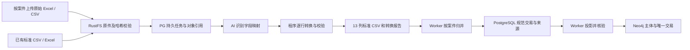

# 银行流水案件处理与分析

创建及维护日期：2026-10-06。版本：v2。范围：原始表格的 AI 标准化、案件导入、后台归并、干净资金图、来源核对和跨案资料纳入。

## 完整测试案件

`/Users/leonwillow/Desktop/流水/` 顶层全部 16 个文件作为“银行流水测试案件”，没有预先选择交易起点。案件 ID 为 `94a89dd4-9027-4023-ace1-b2ee263ae661`，归属已有管理员 `admin`，本轮资料及图版本均为 3。原文件未修改。

16 个文件均实际调用配置的 `gpt-6.1-sol` 识别工作表和字段，程序按 AI 映射转换全部数据行。首次任务使用真实 Responses API；后续复用已保存的 16 份映射，修正转换器对银行查询失败反馈的分类并重新核验。没有用固定列名解析器替代这些 AI 调用。

| 核对项 | 当前数量 |
| --- | ---: |
| 原文件 | 16（13 XLSX、3 CSV） |
| 原始记录 | 13,121 |
| 合格来源观测 | 12,942 |
| 查询反馈 / 开户资料 | 52 / 6 |
| 不合格记录，未生成交易 | 121 |
| 跨文件重复观测归并 | 5,217 |
| 双边对应归并 | 368 对 |
| 规范交易 / PostgreSQL 交易行 / Neo4j 交易边 | 7,357 / 7,357 / 7,357 |
| 配对候选 / 暂缓入图 | 0 / 0 |
| 有本方流水的账户 | 22 |
| 本方户名冲突 | 1 个账户 |

守恒：13,121 = 12,942 + 52 + 6 + 121；12,942 − 5,217 − 368 = 7,357。全部有效观测均恰好进入一笔规范交易的来源集合；原文件与标准 CSV 一起重新归并，仍为 7,357 笔。16 份标准文件的全部 13 个字段与独立的既有格式解析结果一致。这验证转换一致性和数据守恒，不等于对来源真实性或所有匹配作人工认定。

最新标准文件与核验报告在 `/Users/leonwillow/Desktop/流水/AI标准化结果/`；旧“标准化结果”是 v1 交付快照，其唯一交易数不代表当前版本。

## 从原始文件到资金图



AI 内置为版本化提示词和受限 JSON 映射流程，用户无需创建 Skill、复制提示词或安装开发工具。AI 接收各表的表头、前部及中尾部样本，返回表头行、字段列号、方向值、日期组合和金额单位等规则。程序检查映射依据和列号，直接复制原单元格值；不执行模型代码，也不让模型逐笔重写账号或金额。无法确定的表或关键字段进入报告，不补猜。

`ai-normalizer.ts` 负责 AI 调用、映射应用、行数守恒、整数金额汇总和标准 CSV 往返校验。报告保存模型、提示词/转换器版本、各表映射依据、原始/标准/待核/反馈行数、收支合计，以及标准行到原文件工作表/行号的对应关系。模板仍为用户确认的 13 列，见[导入规范](./funds-import.md)。

当前支持 XLSX、XLS、CSV、TSV，识别 UTF-8、GB18030、UTF-16。PDF、扫描件、图片及 OCR 尚未接入；多段异构表、跨页合并或无法用单表映射表达的资料可能需进一步适配，不能承诺任意文档自动理解。每批最多 32 文件，单文件 20 MB、批次 100 MB；单案 100,000 原始记录，工作表最多 250 列。

## 后台任务及关系存储

| 表 | 职责 |
| --- | --- |
| funds_case | 案件归属、当前资料版本与图版本、置顶和归档状态 |
| funds_source | RustFS 对象引用、哈希、大小、解析结果、是否有效、跨案纳入来源；按案件隔离 |
| funds_revision | 不可覆盖的清洗快照、操作者、动作、人工配对决定 |
| funds_transaction | 当前案件已接受的规范交易，一笔一行；暂缓的歧义组不计入 |
| funds_job / funds_job_file | 持久队列、租约、阶段事件、文件进度、已完成检查点、标准 CSV、转换报告 |
| funds_inclusion | 用户确认的跨案账户资料快照、来源版本、纳入/排除状态 |

`funds-worker.ts` 是独立 Bun 进程。HTTP 上传先把原件写入 RustFS 并回读验证，再原子保存任务和对象引用；关闭页面、重启 HTTP 服务不丢失已排队任务。Worker 通过 PostgreSQL `FOR UPDATE SKIP LOCKED` 领取任务，并锁定案件避免多个消费者同时领取同案任务；每 30 秒续租，租约 5 分钟。已完成的文件不重做；失败退避重试，最多三次后显示失败和手动重试入口。提交时再次核对租约归属，防止旧消费者重复提交。

整批文件完成校验后才原子提交来源、版本和规范交易。导入任务自身承担图同步；人工配对或跨案变更在同一 PostgreSQL 事务内追加持久图同步任务。图不可用时保留 PG 结果与失败原因，恢复后重放最新版本。重复执行同案投影不增加边。

当前原件和任务字节保存于 PG Base64/JSONB，不依赖 Redis、Kafka、对象存储或 Spark。大规模数据、长期原件存储和大量并发任务尚未做容量压测，可在现有边界扩展，不能把本轮测试当成生产吞吐保证。

## 去重和双边对应

1. 原件同案同哈希重复上传不增加来源；新的标准化解释版本可以替换当前解析结果，同时保留旧案件快照。
2. 同侧重复使用本方/对方账户、方向、时间、金额、余额、币种、流水号、摘要及文件内出现次序。保留一份文件内真实重复次数，跨文件重叠合并来源；流水号不是独立唯一键。
3. 收付双方按一致的账户方向、金额、币种分组。秒级时间一致且双方唯一时合并；剩余 60 秒内相互唯一时合并；完整同额连通组两侧数量相等且按时间/行次序可一一对应时整组配对。因此两笔付款对应两笔收款仍是两笔交易。
4. 无对应侧资料的单边流水正常入图。数量冲突或仍有歧义的组暂缓入图，保存候选和所有来源供核对，避免把可能同一笔转账画成两条边。人工可合并或保留为两笔。
5. 增量补充后通过证据重叠保留既有规范交易 ID；自动归并可根据新证据重算，不把初次推断当作不可变事实。人工决定带案件版本，旧版本写入会被拒绝。

60 秒是首版明确规则，并非银行通用的事实标准。当前未实现按银行自动学习记账偏移、交易配对决定撤销或逐字段修正。解析器拒绝丢失精度的账号、无效时间、零/负金额等；退款/冲正不简单取绝对值。不能归并的缺口与不能解析的待核记录分开统计。

## 干净的主体交易图

Neo4j 只投影 `FundsNode:FundsSubject` 主体节点和 `TRANSFER` 交易边；不投影原始行、重复来源、任务、账户归属边或案件元节点。每条边保留原收付款账号、交易时间、整数分金额、规范交易 ID 和来源引用。唯一约束为 `(caseId, subjectId)` 和 `(caseId, transactionId)`。

同一案件内 Worker 按证件优先识别主体；无证件时，规范化后完整且唯一的户名可自动归组，并标为 `name-inferred`（户名推断）。同名出现不同证件、同一账户证件冲突、遮蔽或缺失户名时不强行归组；缺失账号仍是交易专属未知节点。`documented` 仅表示来源中有一致证件依据，不表示已经外部认证。模板不增加字段。主体节点保存成员账户信息，每条规范交易仍保留原收付款账号，所以账户视图可完整还原，不复制图中交易。

账户目录、图、交易分页、汇总和时间有序穿透从 Neo4j 查询。`GET /api/funds/cases/:caseId/graph` 返回当前案件筛选范围的完整事实图，不按双方是否已取得流水筛选，也不使用明细分页上限。无筛选时包含全部已入图节点和交易；同一双方的多笔交易各有独立 ID。前端取得整案完整事实后按账户或主体投影，在同一批交易上应用日期、双方及方向筛选，再逐笔展示或按有向双方和币种汇总；明细分页不重新加载画布。查询失败返回明确错误，不用部分交易冒充全图。PG 保留基础交易及证据，用于核对、重算和投影。金额用 BigInt/整数分计算和存储，HTTP 用十进制字符串；模板固定人民币，原表外币不能无标记转换进模板。时间采用 UTC+8，不补猜缺失时分秒。

完整图在单一 Neo4j 写事务中按案件替换，成功后推进 PG 图版本；资料与图版本不一致时分析返回 409。每次任务对照入图笔数与规范交易数。跨库采用可重放和幂等保证，不声称分布式原子事务；尚未提供长期查询固定历史图版本。

## 案件隔离与可撤销纳入

所有来源、任务、规范交易、版本和图查询携带案件 ID。案件访问要求资金调查权限，并且为案件所有者或管理员。默认不跨案联合查询，也不因同名或相同账号自动共享流水。

“跨案线索”只提示当前用户有权访问案件中的**相同完整账号**、户名、来源案件和版本，不返回交易、金额、余额或时间范围。用户明确确认后，复制该版本中以所选账户为本方或对方的资料快照到当前案件，重新去重并同步图。来源后续更新不会自动传播。排除仅停用本次纳入的来源，重新计算当前案；原案和本案独立取得的来源不删除，仍可再次纳入。

当前线索不支持仅凭同名判断跨案身份，也未实现按证件跨账户检索、案件成员协作权限。接口与下载均检查案件归属，不允许提交任意 Cypher。

## 页面与分析边界

资金分析 `/funds` 和案件管理 `/funds/cases` 继承既有 AIDesk 工作区与共享 UI；通过 Eden 调用 Elysia，G6 按需加载。分析页只展示当前案件、账户目录、筛选、资金图及明细；选案、新建、模板、清洗、跨案线索和后台任务统一放在案件管理。全局侧栏与命令搜索只保留“资金分析”入口；图标右侧的案件列表承担搜索与选案，可悬停展开或按用户偏好固定，管理页不再保留案件下拉框；模块页头的“分析 / 案件管理”内部导航传递 URL 中的案件 ID，两页共用 `funds` 授权，侧栏始终选中资金分析。案件管理的文件页默认“原始文件 · AI 标准化”，也可直接导入标准 CSV/Excel。任务显示阶段、文件完成数、重试错误、逐文件报告、规范笔数、重复/双边归并数、暂缓数量、资料/图版本和落库核验。

可按任意账户、一笔或多笔交易、交易双方及日期选择范围，再继续补充同案文件。追踪最多 10 个交易起点、1–4 层、每起点最多 200 条路径；路径时间不递减且相邻交易的收付款账号连续，主体合并不意味着不同账户余额可以直接相互花用。超限明确提示，图与明细按交易 ID 去重。

当前是已观察交易的关联查询；闭环、同额或快进快出不等于原款回流。尚未实现余额背景下的 FIFO/比例资金分配、回流概率预测、风险模型和持久补查任务。

## 本地启动与验证

先配置 `apps/server/.env` 的 PG、Neo4j、认证配置，以及 `FUNDS_AI_BASE_URL`、`FUNDS_AI_API_KEY`、`FUNDS_AI_MODEL`。本轮已使用用户提供的兼容接口和模型，不在文档复制凭据。

```sh
bun install
bun run db:start
bun run db:migrate
bun run dev
# 另开一个终端启动独立计算进程
bun run --cwd apps/server worker
```

构建后 Worker 使用 `bun run --cwd apps/server start:worker`。整目录提交使用与页面相同的入队服务：

```sh
cd apps/server
bun src/submit-funds.ts /Users/leonwillow/Desktop/流水 admin 94a89dd4-9027-4023-ace1-b2ee263ae661
```

`import-funds.ts` 是旧版已知表格解析工具，不是新的 AI 入口。标准化提示词和转换规则在 `modules/funds/ai-normalizer.ts`，无需另建个人 Skill。

检查命令为 `bun run verify:all`，包含 lint、类型、UI、架构、单元、构建、部署和真实 PG/Neo4j API 集成测试。测试覆盖数量守恒、长编号、金额、时间、重复次数、双边组配对、稳定交易 ID、租约恢复、图重放、跨案确认/排除和下载隔离。UI 验证另见[界面记录](./funds-ui.md)。


## 案件导航和原件存储补充（2026-10-06）

进入 `/funds` 没有 `caseId` 时保持未选案状态，不回退第一个案件。案件菜单提供新增、按提交的关键词搜索、鼠标悬停或键盘可见焦点显示的置顶和归档操作。普通点击焦点不使图标常显，图标提供 Tooltip；置顶使用 success、归档使用 warning。置顶单独分区，分组内拖放或 Alt+上下方向键调整顺序并保存到 PostgreSQL。顶部归档入口切换整个列表，提供返回、恢复和删除；二级栏没有 X 关闭按钮，浮层通过移出、点击外部或 Escape 收起。固定菜单的 hover 只显示资金分析提示气泡，浮动模式只打开案件列表。移除二级栏底部管理按钮，点案件进入当前内部页面。

仅归档案件可标记删除，记录 `deleted_at` / `deleted_by`，取消未完成任务并阻止继续访问、下载、入队和跨案提示。PostgreSQL 记录、Neo4j 图与 RustFS 原件保留。入队、重试、提交与删除共用案件行锁，领取任务排除已删除案件。重新归并时旧规范交易改为标记失效，有效交易按稳定 ID 更新或恢复；历次完整快照仍保留。全局业务删除规则见项目结构文档，界面验证见 `funds-ui.md`。

RustFS 使用官方 `rustfs/rustfs:1.0.1` 和 AWS S3 SDK，启动入口注入存储，健康检查不依赖对象存储。桶/路径与下载均按案件限制，worker 通过对象引用读取原件；已有 16 文件完成迁移。配置、迁移和备份说明见 [导入规范](./funds-import.md)。


## 合并分析（2026-10-06）

分析页以两组独立分段选择提供四种组合：账户＋逐笔、账户＋汇总、主体＋逐笔、主体＋汇总。默认账户＋逐笔保持完整事实展示。汇总键为付款节点、收款节点、币种；金额以 BigInt 整数分累加，A→B 与 B→A 分开、不做净额抵销。同主体内部划转保留为自环，并明确标注。点击汇总边或“展开交易”可查看构成它的原交易，再核对银行来源；汇总 ID 不用于证据或追踪 API。

“案件管理 → 清洗核对 → 主体归属”显示多账户组、识别依据和成员账号；可搜索并选中账户人工合并、分别独立，也可撤销人工调整。人工决定保存在本案不可变版本快照中，撤销仅标记 `deletedAt`，原账户、交易及来源不删除。新导入继承有效调整。新接口为 `GET/POST /cases/:caseId/subjects`、`DELETE /cases/:caseId/subjects/:overrideId`，均经过案件权限、有效账户和版本校验。

后续导入在 Worker 提交规范版本时自动识别主体；已有案件可点击“重新识别主体”，经 `/subjects/scan` 入队。任务有租约及重试幂等保护；图同步成功后报告主体数、多账户组数、户名推断组数、规范交易笔数与图版本。数据库维持一笔规范交易一条 TRANSFER；聚合仅是查询结果的分析投影。账户连续性仍是时间路径条件，不因同一主体而跨卡推断资金可支用。

本案验证：版本 3→5 的全部规范交易对象完全一致，仍为 7,357 笔。账户视图 1,291 节点，主体视图 1,154 节点（均含 475 个账号缺失的独立节点）；账户汇总 1,564 条有向流向、主体汇总 1,377 条。四种视图均覆盖 7,357 笔，整数分总和均为 53,386,602,216。赵佳按完整户名推断归组 8 个账号，其中 3 个已有本方流水、5 个仅见对手，涉及 1,004 笔交易及 130 条主体流向。示例双向关系：贺昌兰→赵佳 84 笔合计 ¥3,478,417.96，赵佳→贺昌兰 26 笔合计 ¥2,806,341.08；二者分别展示。

完成的主体识别报告为 679 个已知主体、68 个多账户组，其中 67 组包含户名推断；32 个因身份资料缺失或冲突保持独立，不阻塞交易分析。原始证件列支持“证件号码 / 证照号码 / 身份证号码”等，优先通过规范化观测的原始行位置关联本方账户，避免依赖某一种银行账号表头。
